# Sleep, HRV, menstrual cycle and marathon training: a single-subject study

Garmin Connect export + Clover period tracker · May 2025 – September 2026 · generated 22 Oct 2026

| Value   | Metric                    | Detail                                |
|:--------|:--------------------------|:--------------------------------------|
| 489     | Nights of sleep data      | May 2025 – Sep 2026                   |
| 7.4 h   | Mean sleep / night        | SD 1.2 h                              |
| 61 ms   | Mean overnight HRV        | 491 nights, from May 2025             |
| 14      | Menstrual cycles with HRV | completed cycles overlapping HRV data |
| 203     | Runs analysed             | 1657 km total                         |

## Key findings

1. **The menstrual cycle drives the HRV dip, not the other way round.** HRV is highest in the follicular phase (65.8 ms) and lowest in the luteal phase (57.4 ms; Mann–Whitney p < 0.001). Against my own baseline, HRV falls about **6–8 ms in the 5 days before a period** and recovers by day 4–5. Overnight resting HR mirrors this and rises about **3–4 bpm** (Fig. 8). The dip repeats in most cycles whatever their length (Fig. 9). Follicular-phase HRV and stress do *not* predict a longer cycle (ρ = −0.09 and +0.07, n = 14 cycles), so the data fit “cycle → low HRV” better than “low HRV → delayed period”. With 14 cycles, a small effect in the other direction can't be ruled out.
2. **Low-HRV nights are short, shallow nights.** On nights below my Garmin HRV baseline I slept **~1 h less** (6.5 h vs 7.4 h), got less REM, and my overnight resting HR was 9 bpm higher. Across all nights HRV tracks sleep *quality* (ρ = 0.61) far more than sleep *length* (ρ = 0.18), and later bedtimes go with lower HRV (ρ = −0.21).
3. **Stress takes REM and total sleep, not deep sleep.** After the most stressed fifth of days I sleep about **65 min less** than after the calmest fifth, and REM alone accounts for 38 min of that. Deep sleep barely changes (Fig. 13).
4. **Sleep has been stable overall (7.4 h, score ≈ 80).** Weaker months show low REM (≈0.9–1.0 h vs ≈1.5 h in good months), and deep sleep has crept up over time (≈1.2 h → ≈1.4 h).
5. **Marathon block: running HR dropped ~9 bpm while weekly volume tripled to ~60 km.** Easy pace also slowed slightly, so most of the HR drop reflects easier running rather than a big efficiency gain.
6. **Higher-HRV weeks were faster weeks.** Weekly HRV was the best correlate of pace excluding the long run (ρ = −0.35, p = 0.027; negative = faster). Sleep score and sleep hours were weaker and not significant.
7. **Resting HR rose during the block even as running HR fell.** Overnight resting HR went from 63.3 bpm (base) to 66.1 bpm (block) and HRV from 64.2 to 55.8 ms, peaking around the taper and race. That window also contained the only long cycle of the year. This supports, but doesn't prove, the idea that heavy strain can delay a period. Similar strain later in the year came with normal-length cycles.
8. **Cycles became more regular over the marathon year.** 12 of 31 logged cycles since 2023 were longer than 35 days. In 2025, 67% of cycles were long (mean 42 d), vs 14% in 2026 (mean 34 d).
9. **Tonight's HRV and sleep score are both partly predictable from today.** On held-out nights (18 May → Sep 2026) the model explains 44% of the variance in HRV (error 7.8 ms vs 10.7 ms naive) and 42% in sleep score (error 6.4 vs 8.3 points). HRV is driven mainly by last night's HRV and today's daytime stress. For sleep score, **bedtime and daytime stress** are the strongest levers. Running more the day before has a small negative effect on both, and the luteal phase lowers both slightly (p ≈ 0.02–0.03).

## 1. Introduction

My overnight heart rate variability (HRV) varies a lot across the month, and low-HRV nights often coincide with poor sleep. These changes appear linked to the menstrual cycle, but the direction is unclear: does the cycle lower HRV, or does a stretch of low HRV (stress, training load, poor sleep) delay the cycle? Resting heart rate also fluctuates noticeably.

The study uses my own wearable data to (i) describe how my sleep changed over time, (ii) test how HRV, sleep and stress vary across the menstrual cycle, and test the direction of the HRV–cycle link, (iii) relate daytime and overnight stress to sleep stages, (iv) look at how heart rate and pace changed through marathon training and whether sleep/HRV explain good and bad weeks, and (v) build a simple model to predict the next night's sleep quality and HRV.

## 2. Methods

- **Data.** Garmin Connect GDPR export: nightly sleep (stages, sleep score, sleep stress, respiration), overnight HRV and resting HR from the Health Status feature (HRV for May–Sep 2025, which that feed lacks, is recovered from the watch's raw FIT files: `hrv_status_summary` messages, which match Health Status on 99.7% of overlapping nights), daily summaries (stress, Body Battery, steps), and 203 runs. Period dates come from the Clover app (14 completed cycles in the study window).
- **Processing.** Raw JSON is parsed and joined in **Apache Spark (PySpark)** into one row per day (`daily`) and one row per run (`runs`). Garmin dates sleep by the wake-up morning, so the previous day's stress and training are joined as predictors of each night. Statistics use pandas / SciPy / statsmodels.
- **Cycle phases.** Menstrual = logged bleeding days. Ovulation is estimated as 14 days before the next period (a standard luteal-length assumption, since no ovulation tests were logged). Ovulatory = ovulation ±1 day. Follicular = between bleeding and the ovulatory window. Luteal = after the ovulatory window. The current, unfinished cycle has no phase beyond bleeding.
- **Detrending.** HRV and resting HR also drift with fitness and season. For cycle analyses each night is expressed as a deviation from a centred 35-day rolling median, so only within-month variation is left.
- **Statistics.** Spearman rank correlations (robust to outliers and non-linearity) with Fisher-z 95% CIs; Kruskal–Wallis / Mann–Whitney for group differences; OLS with Newey–West errors for the predictive model, evaluated on the last 25% of nights as a hold-out set. Nightly data are autocorrelated, so p-values for daily correlations are optimistic. Treat ρ and its CI as the main result.
- **Training.** Base build: 25 Aug 2025 → 15 Mar 2026. 10-week block: 15 Mar → 24 May 2026 (race). Long run = the longest run of each week if ≥10 km. Running efficiency = speed (m/min) ÷ average HR.

## 3. Sleep since getting the Garmin

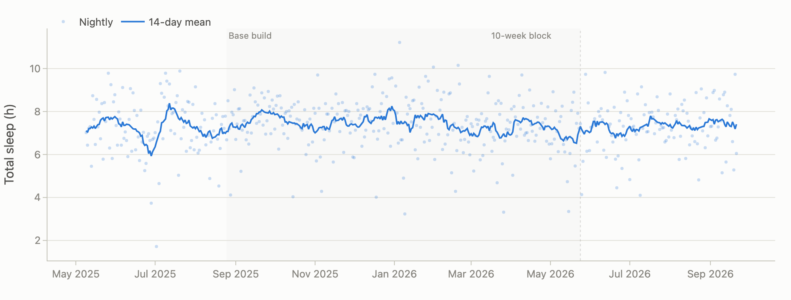

*Figure 1. Total sleep time per night (light dots) and centred 14-day rolling mean. Grey bands mark the marathon base build and 10-week block; dotted line is race day.*

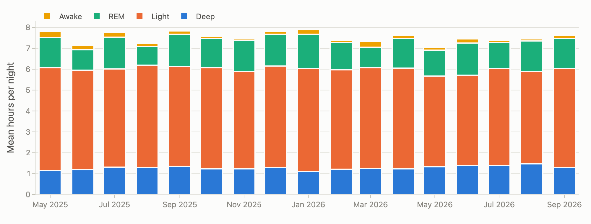

*Figure 2. Monthly mean sleep architecture (hours per night by stage). Months with <10 recorded nights are excluded.*

#### Monthly sleep table

| Month    |   Nights |   Total |   Deep |   Light |   REM |   Awake |   Sleep score |
|:---------|---------:|--------:|-------:|--------:|------:|--------:|--------------:|
| May 2025 |       22 |    7.51 |   1.16 |    4.91 |  1.44 |    0.3  |            79 |
| Jun 2025 |       30 |    6.93 |   1.18 |    4.77 |  0.97 |    0.22 |            73 |
| Jul 2025 |       31 |    7.54 |   1.32 |    4.69 |  1.54 |    0.21 |            82 |
| Aug 2025 |       30 |    7.09 |   1.28 |    4.92 |  0.89 |    0.15 |            74 |
| Sep 2025 |       30 |    7.68 |   1.35 |    4.79 |  1.54 |    0.15 |            85 |
| Oct 2025 |       30 |    7.46 |   1.23 |    4.84 |  1.4  |    0.1  |            82 |
| Nov 2025 |       28 |    7.39 |   1.23 |    4.66 |  1.5  |    0.09 |            81 |
| Dec 2025 |       31 |    7.68 |   1.3  |    4.86 |  1.52 |    0.15 |            81 |
| Jan 2026 |       30 |    7.68 |   1.11 |    4.93 |  1.64 |    0.2  |            82 |
| Feb 2026 |       27 |    7.28 |   1.21 |    4.76 |  1.31 |    0.12 |            78 |
| Mar 2026 |       31 |    7.05 |   1.25 |    4.81 |  0.99 |    0.27 |            74 |
| Apr 2026 |       29 |    7.48 |   1.23 |    4.83 |  1.43 |    0.13 |            81 |
| May 2026 |       30 |    6.91 |   1.33 |    4.34 |  1.24 |    0.12 |            76 |
| Jun 2026 |       30 |    7.26 |   1.39 |    4.33 |  1.54 |    0.2  |            83 |
| Jul 2026 |       31 |    7.29 |   1.38 |    4.66 |  1.25 |    0.1  |            79 |
| Aug 2026 |       29 |    7.35 |   1.46 |    4.44 |  1.45 |    0.1  |            81 |
| Sep 2026 |       20 |    7.48 |   1.28 |    4.75 |  1.45 |    0.12 |            80 |
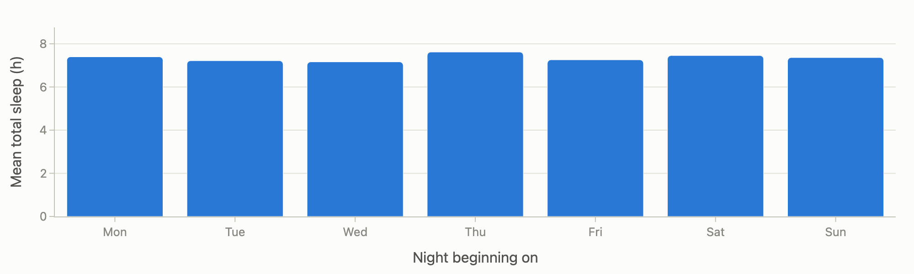

*Figure 3. Mean total sleep by the weekday on which the night begins.*

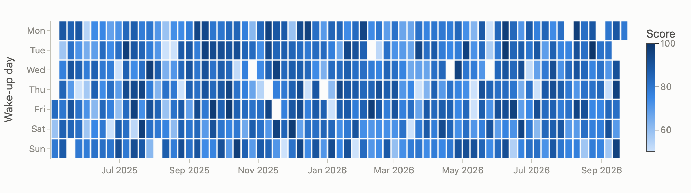

*Figure 4. Every night since May 2025, coloured by Garmin sleep score (darker = better). Pale streaks show runs of poor nights.*

## 4. Sleep and HRV

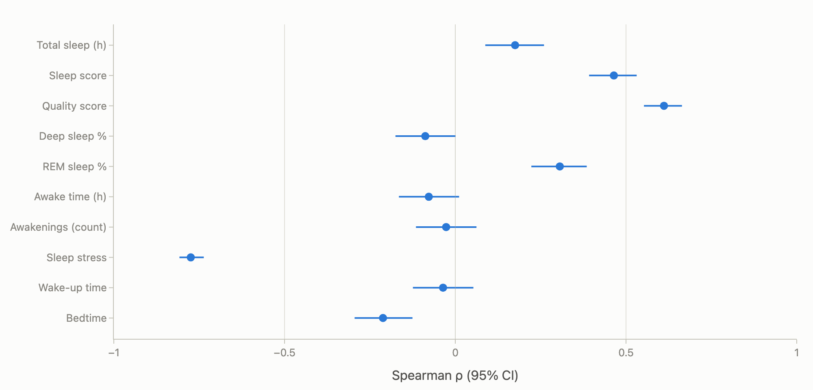

*Figure 5. Spearman correlation between overnight HRV and each sleep metric from the same night. Whiskers are 95% CIs (Fisher z). Hover for p and n.*

*Nights where HRV fell below Garmin's personal baseline range vs all other nights.*

| Metric               |   Low-HRV nights |   Other nights | Mann–Whitney p   | n (low / other)   |
|:---------------------|-----------------:|---------------:|:-----------------|:------------------|
| Total sleep (h)      |             6.48 |           7.39 | 0.018            | 20 / 469          |
| Sleep score          |            62.4  |          80.2  | <0.001        | 20 / 469          |
| Deep (h)             |             1.2  |           1.28 | 0.215            | 20 / 469          |
| REM (h)              |             1.05 |           1.37 | 0.039            | 20 / 469          |
| Awake (h)            |             0.16 |           0.16 | 0.959            | 20 / 469          |
| Wake-up time (h)     |             7.47 |           7.9  | 0.324            | 20 / 469          |
| Sleep stress         |            31.2  |          15.5  | <0.001        | 20 / 469          |
| Resting HR overnight |            72.9  |          63.9  | <0.001        | 20 / 339          |
| Body Battery peak    |            46.6  |          83.6  | <0.001        | 20 / 469          |

## 5. Menstrual cycle, HRV and sleep

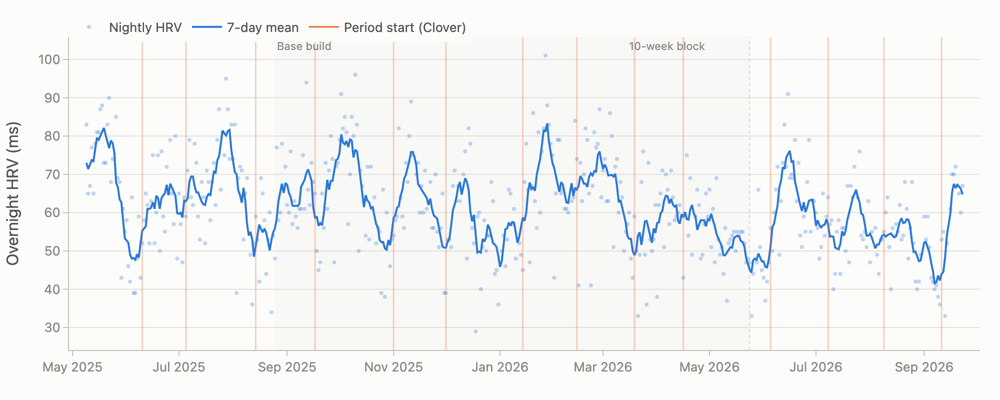

*Figure 6. Overnight HRV with period start dates overlaid. Repeating dips just before a period (vertical lines) show as a saw-tooth pattern in the 7-day mean.*

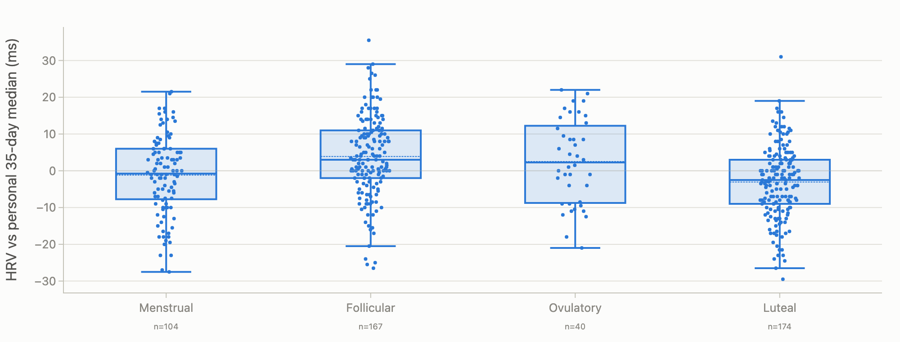

*Figure 7. Detrended HRV by estimated cycle phase. Box = IQR, line = median, dashed = mean. Ovulation is estimated as 14 days before the next period. Detrending removes slow changes from training and season.*

*Mean of each metric by cycle phase.*

| Metric                         |   Menstrual |   Follicular |   Ovulatory |   Luteal | Kruskal–Wallis p   |
|:-------------------------------|------------:|-------------:|------------:|---------:|:-------------------|
| HRV (detrended, ms)            |       -1.17 |         3.89 |        2.52 |    -3.05 | <0.001          |
| HRV (raw, ms)                  |       59.38 |        65.8  |       62.65 |    57.4  | <0.001          |
| Overnight RHR (detrended, bpm) |        0.61 |        -1.19 |       -0.09 |     1.65 | <0.001          |
| Sleep score                    |       79.12 |        82.07 |       80.97 |    76.82 | <0.001          |
| Total sleep (h)                |        7.39 |         7.44 |        7.3  |     7.27 | 0.378              |
| Deep sleep %                   |       17.78 |        17.91 |       18.78 |    17.46 | 0.319              |
| REM sleep %                    |       17.48 |        19.93 |       19.59 |    16.62 | <0.001          |
| Awake time (h)                 |        0.15 |         0.15 |        0.13 |     0.18 | 0.513              |
| Sleep stress                   |       16.06 |        14.59 |       15.77 |    18.01 | <0.001          |
| Daytime stress                 |       40.23 |        39.11 |       39.1  |    42.18 | 0.024              |
| Respiration (brpm)             |       15.65 |        15.19 |       15.36 |    15.48 | <0.001          |
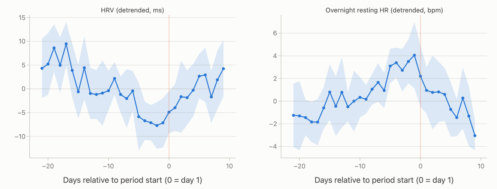

*Figure 8. HRV and overnight resting HR aligned to period start (mean ± 95% CI across cycles). Negative days = days before the period. Orange line = first day of bleeding.*

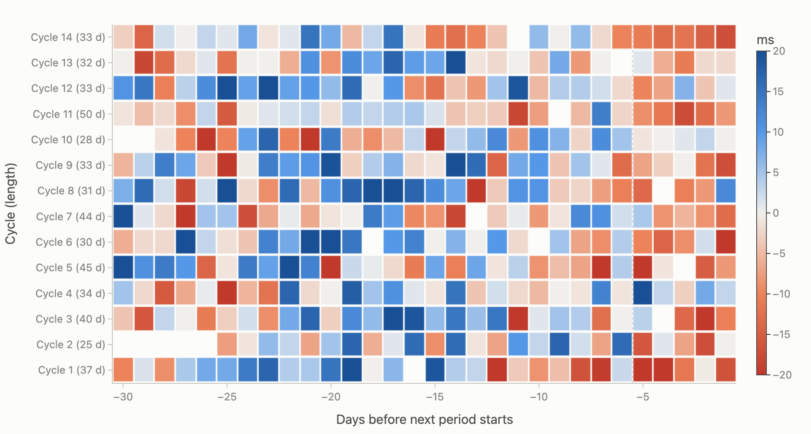

*Figure 9. One row per completed cycle, lined up on the next period. Blue = HRV above my 35-day baseline, red = below. The red band to the right of the dotted line (last ~5 days) repeats in most cycles, whatever their length. That points to the cycle driving HRV.*

### Which way round? Cycle → HRV, or HRV → delayed period

If the cycle drives HRV, HRV should follow the same within-cycle pattern every month regardless of cycle length (Figures 8–9). If low HRV (stress, load) delays the period, it would have to act *before ovulation*, because a late period almost always means late ovulation (the luteal phase is fairly fixed). So follicular-phase HRV/stress should predict cycle length.

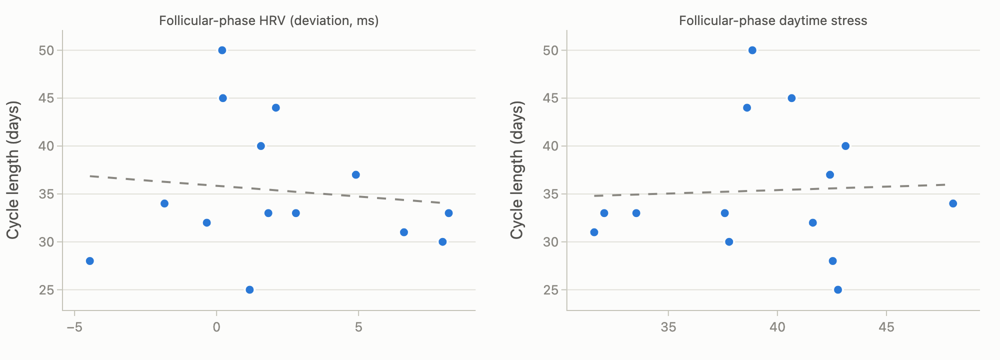

*Figure 10. Each dot is one completed cycle (cycles with ≥5 HRV nights in the first half). If low HRV or high stress before ovulation delays ovulation, lower HRV / higher stress should go with longer cycles (a negative slope on the left, a positive slope on the right). Dashed line = least-squares fit.*

*Cycle-level correlations (direction-of-effect test). n is the number of cycles, so power is low.*

| Variable X                  | Variable Y   |   Spearman ρ | 95% CI         |     p |   n |
|:----------------------------|:-------------|-------------:|:---------------|------:|----:|
| Follicular HRV deviation    | Cycle length |        -0.09 | [-0.59, +0.47] | 0.77  |  14 |
| Follicular HRV (raw)        | Cycle length |         0.09 | [-0.46, +0.60] | 0.747 |  14 |
| Follicular daytime stress   | Cycle length |         0.07 | [-0.48, +0.58] | 0.805 |  14 |
| Follicular sleep score      | Cycle length |         0.37 | [-0.20, +0.75] | 0.195 |  14 |
| Previous cycle's luteal HRV | Cycle length |         0.57 | [+0.03, +0.85] | 0.041 |  13 |

#### Per-cycle table

| Cycle start   |   Length (d) |   Follicular HRV |   Luteal HRV |   Last-7-day HRV dev. |   Follicular stress |   Follicular sleep score |
|:--------------|-------------:|-----------------:|-------------:|----------------------:|--------------------:|-------------------------:|
| Cycle 1       |           37 |             77.1 |         51.2 |                 -12.5 |                42.4 |                     80.4 |
| Cycle 2       |           25 |             59.9 |         62.5 |                  -4.3 |                42.8 |                     77.3 |
| Cycle 3       |           40 |             69.4 |         61   |                  -9.9 |                43.1 |                     85.2 |
| Cycle 4       |           34 |             58.3 |         65.8 |                   7.7 |                48.1 |                     75.3 |
| Cycle 5       |           45 |             69.6 |         55.2 |                 -11   |                40.7 |                     84.1 |
| Cycle 6       |           30 |             68.2 |         59   |                  -8.6 |                37.8 |                     81.8 |
| Cycle 7       |           44 |             58.6 |         54.5 |                  -2.6 |                38.6 |                     82.4 |
| Cycle 8       |           31 |             70.9 |         65.8 |                  -6.3 |                31.6 |                     84.7 |
| Cycle 9       |           33 |             69.8 |         60.2 |                  -7.3 |                33.5 |                     77.6 |
| Cycle 10      |           28 |             54.7 |         62.5 |                   2.8 |                42.5 |                     72.8 |
| Cycle 11      |           50 |             55.3 |         45.8 |                  -6.9 |                38.9 |                     78.8 |
| Cycle 12      |           33 |             68.1 |         59.7 |                  -1.9 |                32.1 |                     84   |
| Cycle 13      |           32 |             56.2 |         52.8 |                  -3.3 |                41.6 |                     78.4 |
| Cycle 14      |           33 |             56.6 |         46.1 |                 -11.4 |                37.6 |                     83.3 |

### Cycle history, 2023–2026 (Clover)

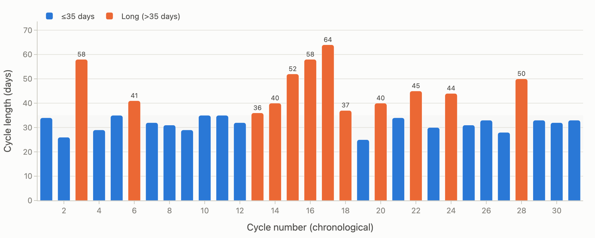

*Figure 11. Length of every logged cycle in Clover (31 completed cycles, 2023 – 2026), in chronological order. Grey band = typical 21–35-day range; orange = longer than 35 days.*

7 calendar months in the tracking window had no period at all. Period length is logged as 7 days in 30 of 32 cycles (likely the app default), so it carries little information; the exception is a 13-day period.

*Cycle length by year (by cycle start).*

|   Year (cycle start) |   Cycles |   Mean length (d) |   Median (d) |   Longest (d) |   Cycles >35 d |   % long |
|---------------------:|---------:|------------------:|-------------:|--------------:|---------------:|---------:|
|                 2023 |        5 |              36.4 |           34 |            58 |              1 |       20 |
|                 2024 |       10 |              36.3 |           35 |            52 |              4 |       40 |
|                 2025 |        9 |              41.9 |           40 |            64 |              6 |       67 |
|                 2026 |        7 |              34.3 |           33 |            50 |              1 |       14 |

## 6. Stress and sleep stages

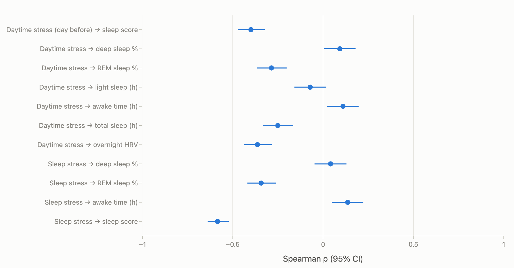

*Figure 12. Spearman correlations between Garmin stress and sleep stages. ‘Daytime stress’ = mean awake-time stress on the day before the night. ‘Sleep stress’ = mean stress during that night (largely the inverse of HRV, so expect strong links).*

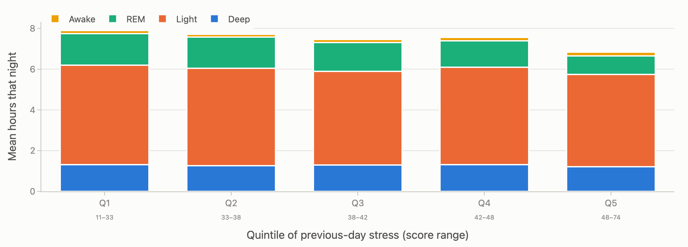

*Figure 13. Sleep architecture by quintile of the previous day's mean daytime stress (each quintile ≈ 100 nights).*

## 7. Marathon training block

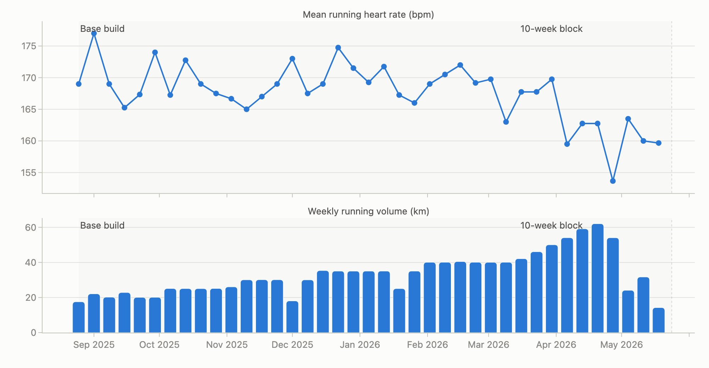

*Figure 14. Weekly mean of per-run average heart rate (top) and weekly distance (bottom) from 25 Aug 2025 to race week. The race itself is excluded.*

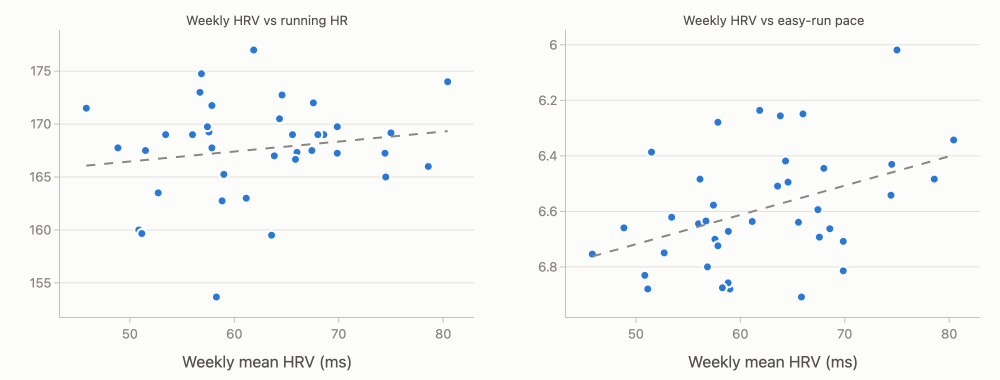

*Figure 15. Each dot is one training week. Pace axis is reversed so ‘faster’ is up. Dashed line = least-squares fit.*

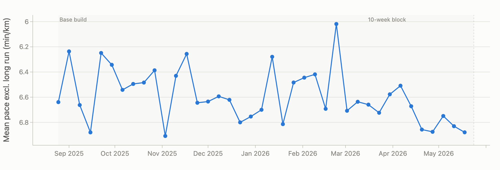

*Figure 16. Weekly mean pace of all runs except that week's long run (the longest run of the week, if ≥10 km). Only weeks with ≥2 such runs. Axis reversed: higher = faster.*

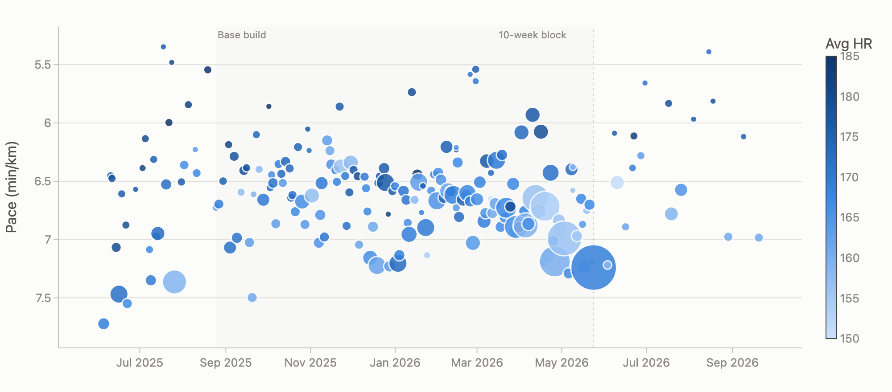

*Figure 17. Every run: bubble size = distance, colour = average HR (darker = harder). Long runs grow through the block and bubbles get lighter: HR falls, but easy pace also slows slightly.*

### Resting heart rate through the training block

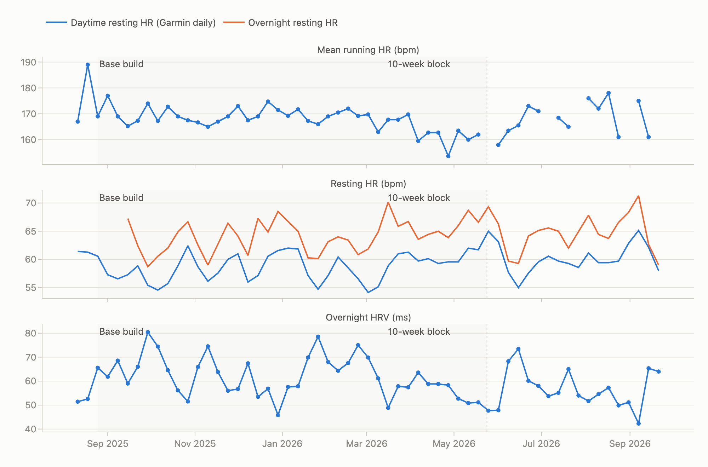

*Figure 18. Weekly running HR, resting HR and HRV from the start of training. Grey = training phases. Through the block, running HR falls while resting HR rises and HRV falls. That pattern is consistent with accumulated fatigue, and it peaks in the same window as the 50-day cycle. Note that Jul–Sep 2026 shows similar resting values without a training block.*

*Mean resting physiology by training period.*

| Period                      |   Daytime RHR | Overnight RHR   |   HRV |   Sleep score |   Nights |
|:----------------------------|--------------:|:----------------|------:|--------------:|---------:|
| Pre-training (Jun–Aug 2025) |          59   | —               |  62.2 |          76.1 |       84 |
| Base build                  |          58.1 | 63.3            |  64.2 |          81.2 |      202 |
| 10-week block               |          60.3 | 66.1            |  55.8 |          77.5 |       71 |
| 8 weeks post-race           |          59.8 | 64.2            |  58.2 |          79   |       56 |
| Later (Jul–Sep 2026)        |          60.8 | 65.6            |  55   |          81.2 |       66 |
*Training load vs resting physiology (weekly, from Aug 2025), and cycle-level resting HR vs cycle length.*

| Variable X                      | Variable Y                  |   Spearman ρ | 95% CI         |     p |   n |
|:--------------------------------|:----------------------------|-------------:|:---------------|------:|----:|
| Weekly volume (km)              | Weekly daytime resting HR   |        -0.11 | [-0.36, +0.16] | 0.438 |  54 |
| Weekly volume (km)              | Weekly overnight resting HR |         0.07 | [-0.22, +0.34] | 0.647 |  49 |
| Weekly volume (km)              | Weekly HRV                  |         0.15 | [-0.13, +0.40] | 0.289 |  54 |
| Cycle mean daytime resting HR   | Cycle length                |        -0.17 | [-0.64, +0.40] | 0.572 |  14 |
| Cycle mean overnight resting HR | Cycle length                |         0.19 | [-0.50, +0.73] | 0.599 |  10 |
*Week-level correlations during training (25 Aug 2025 – 23 May 2026). For pace, a negative ρ means more of X goes with faster running.*

| Variable X            | Variable Y          |   Spearman ρ | 95% CI         |     p |   n |
|:----------------------|:--------------------|-------------:|:---------------|------:|----:|
| Weekly HRV            | Mean run HR         |         0.07 | [-0.25, +0.37] | 0.688 |  39 |
| Weekly HRV            | Easy-run HR         |        -0.01 | [-0.32, +0.31] | 0.951 |  39 |
| Weekly resting HR     | Mean run HR         |         0.01 | [-0.31, +0.32] | 0.972 |  39 |
| Weekly sleep score    | Pace excl. long run |        -0.21 | [-0.49, +0.11] | 0.198 |  39 |
| Weekly sleep hours    | Pace excl. long run |        -0.08 | [-0.39, +0.24] | 0.609 |  39 |
| Weekly deep sleep (h) | Pace excl. long run |         0.18 | [-0.14, +0.47] | 0.266 |  39 |
| Weekly HRV            | Pace excl. long run |        -0.35 | [-0.60, -0.04] | 0.027 |  39 |
| Weekly daytime stress | Pace excl. long run |         0.19 | [-0.14, +0.48] | 0.252 |  39 |
| Weekly volume (km)    | Mean run HR         |        -0.16 | [-0.45, +0.17] | 0.346 |  39 |
*Run-level correlations (non-long runs, all dates). Efficiency = speed ÷ heart rate, so it adjusts pace for effort.*

| Variable X                  | Variable Y              |   Spearman ρ | 95% CI         | p         |   n |
|:----------------------------|:------------------------|-------------:|:---------------|:----------|----:|
| Prior-night sleep score     | Efficiency (m per beat) |        -0.06 | [-0.21, +0.10] | 0.484     | 160 |
| Prior-night HRV             | Efficiency (m per beat) |         0.11 | [-0.05, +0.26] | 0.175     | 160 |
| Prior-night HRV (detrended) | Efficiency (m per beat) |         0.11 | [-0.04, +0.26] | 0.150     | 160 |
| Prior-night total sleep     | Efficiency (m per beat) |        -0.02 | [-0.18, +0.13] | 0.796     | 160 |
| Prior-night sleep score     | RPE                     |         0.02 | [-0.13, +0.18] | 0.781     | 157 |
| Prior-night HRV             | RPE                     |         0.14 | [-0.02, +0.29] | 0.078     | 157 |
| Previous-day stress         | RPE                     |        -0.27 | [-0.41, -0.12] | <0.001 | 161 |
| Previous-day stress         | Efficiency (m per beat) |        -0.02 | [-0.18, +0.13] | 0.770     | 164 |

## 8. Predicting sleep

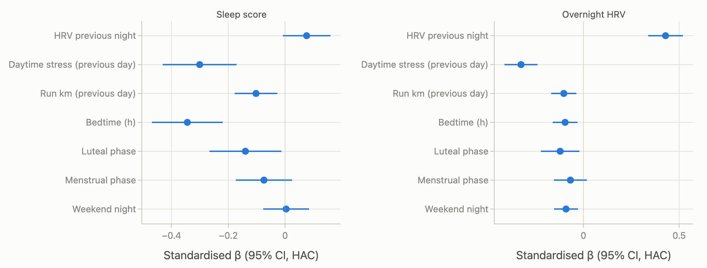

*Figure 19. Standardised regression coefficients predicting tonight's sleep score (left) and overnight HRV (right) from information available beforehand. Units are SDs of the outcome per SD of the predictor (phase/weekend: present vs absent). Newey–West (HAC, 7-day) errors account for day-to-day autocorrelation.*

*Model performance. Out-of-sample R² compares hold-out error with predicting the training mean; values near 0 mean little predictive power beyond the average.*

| Outcome       |   n nights |   In-sample R² |   Out-of-sample R² |   Test MAE |   Naive MAE (mean) | Test period from   |
|:--------------|-----------:|---------------:|-------------------:|-----------:|-------------------:|:-------------------|
| Sleep score   |        476 |           0.32 |               0.42 |        6.4 |                8.3 | 18 May 2026        |
| Overnight HRV |        476 |           0.4  |               0.44 |        7.8 |               10.7 | 18 May 2026        |

## 9. Limitations

- Single subject (n = 1), observational data: correlations, not causal effects. Training, study stress, season and cycle all overlap in time.
- Only 14 completed cycles overlap with HRV data, so the cycle-level direction test (Figure 10) has very low power. A null result there is not evidence of no effect.
- Ovulation is estimated, not measured. Irregular cycles (25–76 days here) make the 14-day luteal assumption less certain. Basal body temperature or LH tests would sharpen the phase boundaries.
- Garmin sleep staging from wrist PPG/accelerometry agrees only moderately with polysomnography, especially for deep vs light sleep. Garmin “stress” is itself derived from HRV, so stress–HRV links are partly built in.
- Weekly pace mixes easy runs, workouts and races. Efficiency (speed ÷ HR) partly adjusts for this, but terrain, heat and workout type are not controlled.
- Life events such as exam periods were not labelled. Adding them as a variable is a natural next step.

Pipeline: raw Garmin + Clover exports → PySpark ETL → SciPy / statsmodels → Plotly. Personal dates have been removed from this public version.
